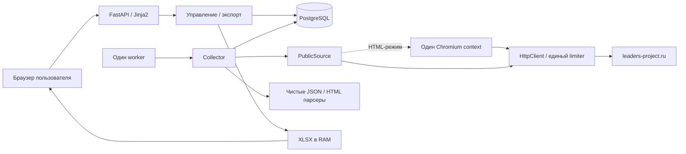

<!-- docs/architecture.md -->
# Устройство сервиса

`app/domain/models.py` содержит независимые DTO, допустимые состояния и ошибки. `app/application` оркестрирует создание/управление заданиями, последовательный сбор и экспорт. Контракты внешних зависимостей — `ports.py`; сборка конкретных реализаций — `app/bootstrap.py` и `app/worker.py`.

HTTP, limiter и browser loading отделены от чистых JSON/HTML-парсеров. `source_urls.py` описывает проверенный публичный протокол, `parsers/public_api.py` валидирует JSON-схему и cursor, `parsers/normalization.py` содержит общую нормализацию. SQLAlchemy и транзакции находятся только в `infrastructure/database`, XlsxWriter — в `infrastructure/excel`. API переводит предметные ошибки в HTTP и передаёт application service через Dependency Injection.

Блокировка worker — сессионный `pg_try_advisory_lock`, удерживаемый отдельным соединением. Перед операциями проверяется его доступность. Задания polling-ом читаются из PostgreSQL; второй worker не обрабатывает каталог одновременно. Создание и управление job защищены unique nullable `slot=1` и row locks. Paused job сохраняет slot. API не выполняет внешний сбор и не зависит от браузерной вкладки пользователя.

Каждый метод репозитория открывает короткую транзакцию. Запросы к источнику выполняются **вне** DB-транзакций. Список страницы, новые компании и следующий cursor сохраняются атомарно. Уникальны `(job_id, detail_url)`, `(job_id, ordinal)`, URL и fingerprint каталожной страницы. Результаты реквизитов и контактов фиксируются раздельно; crash между ними не повторяет уже завершённую операцию. Контрольные действия проверяются перед запросом и сохранением результата. Сбой после HTTP до commit может повторить запрос, но не создаёт повторную запись.

Основной режим получает каталог по серверному `nextCursor`, а текущую компанию — одним публичным GET `/api/v1/companies/{inn}`. В ответе раздельны `leaders`, `founders`, `contacts`, `website`; raw bundle используется только для двух последовательных проверок текущей компании и затем освобождается. Пауза очищает его, перезапуск запрашивает оставшиеся контакты повторно. ИНН проверяется строкой; пропавшие ключи и неизвестная схема не считаются отсутствием данных. При 403 API не переключается на другой способ обхода.

Каталог сразу сохраняет текущую `revenue` в миллионах рублей через Decimal, а карточка — строковый КПП. Миграция `0002` только расширяет схему. Ранее сохранённые компании получают отдельные pending-статусы новых полей; основные статусы и счётчики не сбрасываются. После окончания текущей индексации `FieldBackfill` дозаполняет выручку только существующих URL, используя собственные cursor и таблицу `revenue_backfill_pages`. Затем обычные карточки обрабатываются по прежнему алгоритму; для уже готовых карточек отдельный шаг извлекает только КПП без перезаписи ФИО и контактов. Оба этапа используют тот же Source и durable limiter. Дозаполнение завершённого задания повторно занимает активный slot с прежним UUID.

Durable limiter сохраняет `next_request_at` в БД. Повторный запуск не обнуляет задержку или cooldown. Каждый HTTP-request сериализуется одним async lock, имеет connect/read/write/pool timeouts и общий deadline. Повторный HTTP 429, 403 и CAPTCHA приостанавливают сбор. Browser requests перехватываются и выполняются тем же HTTP-клиентом. Cookies авторизованного пользователя не используются, закрытые страницы не запрашиваются. Обходов блокировок нет.

Экспорт сериализован semaphore/lock на одном API-процессе, чтобы несколько скачиваний не расходовали RAM одновременно. PostgreSQL отдаёт consistent snapshot списка. В RAM создаётся `BytesIO`, а XlsxWriter запускается с `in_memory=True`, `strings_to_formulas=False`, `strings_to_urls=False`; недоверенные значения записываются `write_string`. Один официальный сайт оформляется hyperlink, несколько сохраняются полностью через перенос строки. Для неполных карточек ошибки добавляются даже при отсутствии отдельного Issue.

Контейнеры имеют отдельную Docker bridge network, PostgreSQL не публикует порт и не подключён к `ai-shared`. Публикуется только API с настраиваемым bind/port. Приложения работают непривилегированным пользователем с read-only root filesystem; `/tmp` — tmpfs, browser context не persistent. HTML, скриншоты и XLSX не сохраняются.

UI и API работают без авторизации. Мутации требуют `X-Requested-With: LeadersParser` и проверки Origin; CSP, запрет MIME-sniffing, Referrer-Policy и no-store применяются также к ответам CSRF. Внутренние credentials PostgreSQL и её сетевая изоляция сохранены.

Проверки: pure parsers на предоставленных fixtures; HTTP MockTransport + fake clock; сценарии application/checkpoints и дозаполнения; реальная PostgreSQL для миграции заполненной схемы, гонок и advisory lock; реальный Chromium на синтетической JS-пагинации с восстановлением; API без авторизации, CSRF и download; memory-only XLSX на 37 000 строк; frontend state tests. Автоматические тесты не обращаются к реальному источнику. Ручной `scripts.smoke` ограничен тремя организациями и двумя страницами каталога.
